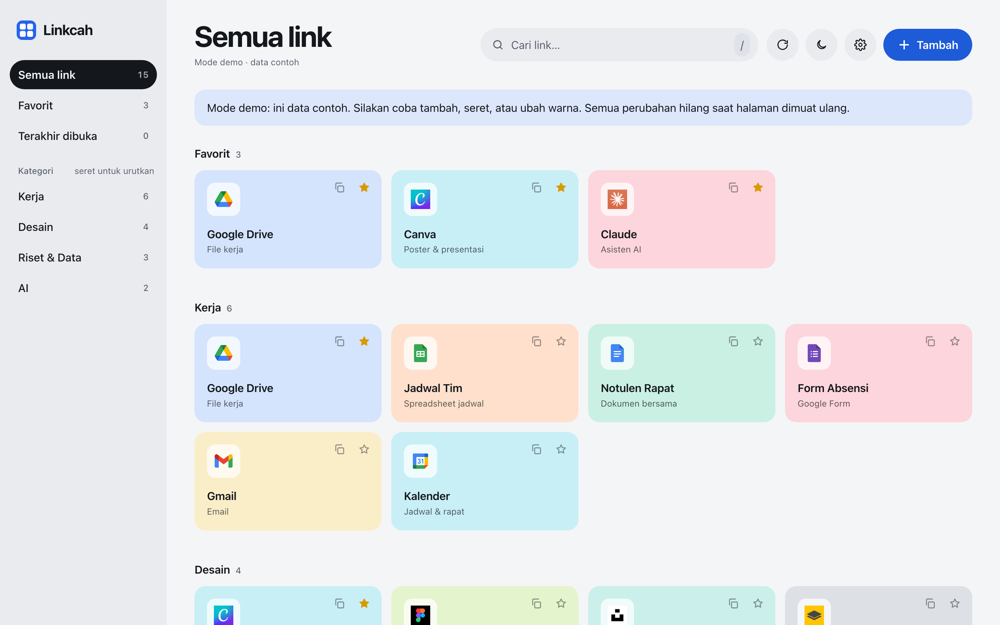
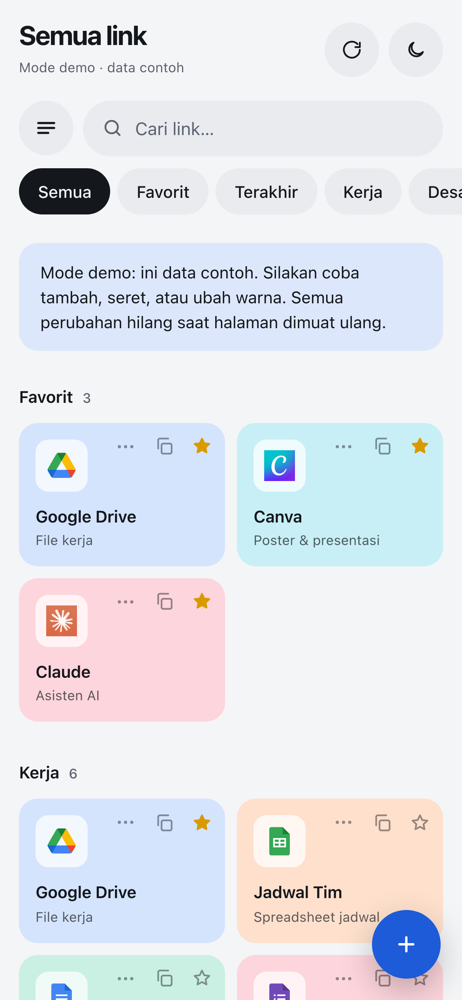
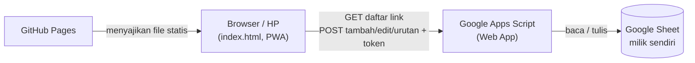

# Linkcah

**Jalan pintas ke semua link kerja.** Satu halaman berisi semua link, rapi di laptop, dan bisa di-install di HP seperti aplikasi.

🔗 **Coba demo:** `https://dionanantach.github.io/linkcah/?demo` (pakai data contoh; perubahan tidak disimpan)

> **In English:** Linkcah is a personal, card-based link launcher. It is a static Progressive Web App on GitHub Pages, with Google Sheets + Apps Script as a token-protected backend, so the data stays in my own Google account and syncs across laptop and phone. I designed and directed it, then built it with AI assistance (Claude for design and code, an agent in Antigravity for deployment).

---

## Masalah

Setiap hari saya membuka link yang sama berulang kali: folder Drive, spreadsheet jadwal, desain di Canva, folder foto kegiatan. Bookmark browser cepat berantakan, sulit dicari, dan di HP lebih merepotkan lagi. Saya butuh satu tempat yang:

- bisa dibuka dengan sekali tap, baik di laptop maupun di HP,
- tersusun per kategori dan bisa saya atur sendiri urutannya,
- selalu sama isinya di semua perangkat,
- gratis, tanpa iklan, dan datanya tetap milik saya.

## Fitur

| | |
|---|---|
| **Card per kategori** | Ikon otomatis dari situsnya, termasuk ikon khusus Drive, Sheets, Docs, Slides, dan Forms |
| **Atur urutan dengan seret** | Kategori dan card bisa disusun manual. Di HP: tahan sebentar lalu geser |
| **Sinkron laptop ↔ HP** | Link, urutan, warna, dan favorit tersimpan di Google Sheet |
| **Akses cepat** | Pencarian (tekan `/` di laptop), favorit, riwayat "terakhir dibuka", tombol salin link |
| **Bisa di-install di HP** | Progressive Web App, tetap bisa dibuka saat offline |
| **Personalisasi** | Warna card manual, tema terang/gelap |

## Arsitektur

- **Frontend:** satu file HTML/CSS/JavaScript tanpa framework, di-hosting gratis di GitHub Pages. Service worker menyimpan tampilan supaya tetap bisa dibuka saat offline.
- **Backend:** Google Apps Script yang menempel di Google Sheet. Setiap permintaan wajib membawa token; tanpa token, permintaan ditolak.
- **Data:** satu baris per link di Sheet, dengan kolom `id, nama, url, kategori, catatan, ikon, warna, favorit, urutan`. Urutan kategori disimpan di Script Properties.

## Keputusan desain dan alasannya

- **Google Sheet sebagai database, bukan server sendiri.** Gratis, tidak perlu dirawat, datanya bisa dilihat dan diedit langsung, dan tetap berada di akun Google saya.
- **Repo publik tanpa rahasia.** Kode boleh dilihat siapa saja, tapi token tidak pernah masuk ke repo. Token hanya ada di Apps Script dan di perangkat saya.
- **"Tahan lalu geser" untuk mengurutkan di HP.** Kalau card dan chip langsung bisa diseret, setiap kali halaman di-scroll urutannya ikut berantakan. Dengan ditahan dulu, scroll biasa dan mengurutkan bisa hidup berdampingan.
- **Card hanya bisa dipindah di dalam kategorinya sendiri.** Pindah kategori sengaja lewat menu Edit supaya tidak terjadi tanpa sengaja.
- **Sinkron saat aplikasi dibuka lagi.** Tidak memakai koneksi real-time yang lebih rumit. Data diperbarui setiap aplikasi kembali dibuka dan setiap satu menit selama terbuka, cukup untuk pemakaian satu orang.
- **Tampilan datar dan tenang.** Tanpa gradient, garis tipis, atau bayangan pada elemen diam. Ukuran huruf memakai skala golden ratio (φ = 1,618) dari 16px. Font sistem Apple (SF Pro) di perangkat Apple, Inter di perangkat lain, karena SF Pro tidak boleh disebarkan sebagai web font.
- **Tidak dijual.** Sempat saya pertimbangkan, tapi setelah dibandingkan dengan alternatif gratis yang sudah matang (bookmark browser, Raindrop.io, start.me), proyek ini lebih bernilai sebagai alat pribadi dan portofolio.

## Peran AI dan peran saya

Proyek ini dibangun dengan bantuan AI, dan saya ingin jujur soal pembagian perannya:

- **Saya:** menentukan masalah dan scope, menyusun kebutuhan fitur, mengarahkan desain, menguji di HP dan laptop sungguhan, menemukan masalah (teks card tidak sejajar, header berantakan di jendela kecil, animasi seret patah-patah, ukuran form terlalu besar), dan memutuskan apa yang dibuat dan apa yang tidak.
- **Claude:** menulis kode frontend dan Apps Script, mengusulkan solusi teknis, dan menguji otomatis dengan browser simulasi (termasuk simulasi sentuhan di HP).
- **Agent di Antigravity:** menjalankan deploy ke GitHub dan Apps Script berdasarkan instruksi tertulis yang aturannya saya tetapkan, misalnya token tidak boleh masuk repo.

Pelajaran terbesarnya: hasil yang baik dari AI datang dari arahan yang jelas, pengujian yang kritis, dan keberanian bilang "ini belum benar".

## Yang saya pelajari

- Cara kerja Progressive Web App dan service worker
- Menjaga rahasia (token) tetap aman di proyek dengan repo publik
- Sinkronisasi data antar perangkat dan menangani backend versi lama tanpa merusak aplikasi
- Interaksi sentuh: membedakan scroll, tap, dan tahan-geser
- Tipografi berbasis skala golden ratio dan desain yang responsif di berbagai lebar layar

## Batasan

- Dirancang untuk satu pengguna. Kalau dua perangkat mengubah link yang sama di waktu bersamaan, perubahan terakhir yang menang.
- Saat setup, Google menampilkan peringatan "aplikasi belum diverifikasi" karena script-nya milik pribadi.
- Ikon diambil dari layanan favicon pihak ketiga, jadi butuh internet untuk tampil. Saat offline, yang muncul huruf awal.

## Menjalankan sendiri

Langkah lengkapnya ada di [SETUP.md](SETUP.md).
